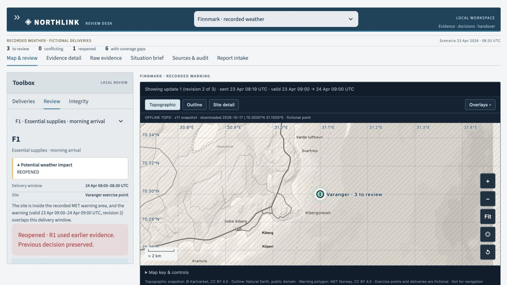
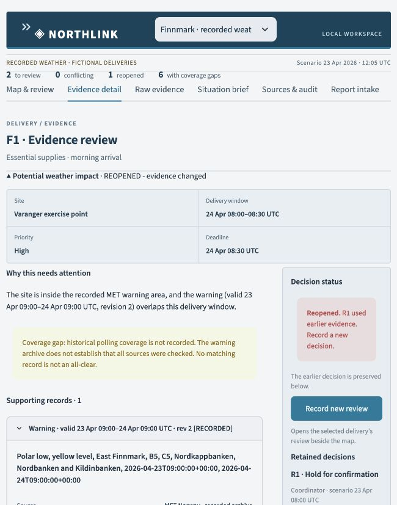

# Northlink

**Keep the evidence behind a decision when connectivity disappears—and reopen the
review when that evidence changes.**

Northlink is a local evidence and review workspace for a fictional Arctic
essential-supply exercise. It combines a map, versioned reports, explicit source
uncertainty, human decisions and a portable handover. Built as an EUDIS Norway
hackathon prototype; it is not an operational military system or a route-safety tool.



## What to try

1. Load an exercise and select a delivery on the map or in the queue.
2. Read the supporting evidence and uncertainty; save a human review.
3. Import a bundled correction. A material change reopens the affected review
   while preserving the earlier decision and its evidence context.
4. Restart locally, inspect the retained decision, and export a JSON handover
   or a deterministic Markdown situation brief.



The map uses prepared Kartverket topography, Natural Earth outlines and recorded
MET warning geometry. It needs no map API key and makes no tile requests at runtime.
The source records, timestamps and content hashes remain inspectable.

## Run locally

Prepare dependencies while connected. The core app needs no AI model or API key.
The verified local environment is macOS arm64 with Python **3.14.7**. The GitHub
workflow is configured for Python 3.14 on Linux; its first hosted run is pending.

From the repository folder on macOS/Linux:

```sh
python3 -m venv .venv
.venv/bin/python -m pip install -r requirements.txt
.venv/bin/python -m pytest -q
.venv/bin/python -m streamlit run app.py
```

On Windows PowerShell, use `.venv/Scripts/python.exe` for the same commands after
`py -3.14 -m venv .venv`. Windows installation has not been verified in this release.

Open **http://localhost:8528**. On a prepared Mac, double-click
`Start-Northlink.command`. Keep the terminal running and the laptop awake during
the demo. Downloading dependencies is a one-time online preparation step;
copying a virtual environment to another computer is not a portable installation.

## Two separate exercises

| Exercise | Data | Demonstration |
|---|---|---|
| Synthetic | Invented deliveries, corridors and reports | Restriction, conflicting reports, freshness, cancellation and late older revision |
| Finnmark · recorded weather | Original April 2026 MET notices, fictional delivery points/windows | Warning validity changes site/time applicability and reopens a review |

Choose a workspace in the top bar; open **Exercise setup & files** with the upper
left chevrons. Workspaces have separate databases. **New practice run** creates a
new database and preserves prior runs. A practice run's session selection does not
survive a full browser reload; use the default workspace for restart acceptance.

### Short recorded-weather demo

1. Choose **Finnmark · recorded weather** and **Load recorded Finnmark exercise**.
2. In **Map & review**, inspect **F1**. Save **Hold for confirmation** with a note.
3. Import **archived update 1**. F1 changes from no match to potential weather
   impact, and its decision becomes **REOPENED**.
4. Inspect the stored before/after and the earlier review; record a new decision.
5. Import **archived update 2**. The warning's material applicability is unchanged,
   so the new review should stay reviewed.
6. Export the handover and situation brief. F3 is the outside-area comparison.

Reference answers: [recorded replay](docs/EXPECTED_REPLAY_RESULTS.md).
**No matching record is not an all-clear.** Matching checks weather exposure at
fictional points and time windows; it does not verify a whole route or road closure.

## Offline checks

After preparing dependencies and saving a review in the default workspace:

1. Stop the app with Ctrl+C and turn Wi-Fi off.
2. Restart it and reload the local page. Inspect the saved decision.
3. Save another review, import a bundled update and download the brief/handover.
4. Reconnect before continuing with a hosted coding assistant.

This physical acceptance check remains to be performed by the presenter. The
automated suite and a browser rehearsal with external Python connections blocked
passed locally. To run with that application-level network guard:

```sh
.venv/bin/python scripts/offline_app.py --server.port 8529
```

That guard is not an OS sandbox or proof that Wi-Fi was physically disconnected.
Live weather refresh and package/model downloads require connectivity. Bundled
maps and recorded reports remain usable with their acquisition/data-mode labels.

## Storage and handover

Local state lives in git-ignored `data/` SQLite files; `NORTHLINK_DB` can override
the base path. Recorded/practice workspaces and the report inbox use separate files.
Do not commit those files or your own report text.

- Imports are validated before an atomic write. Changed content cannot reuse an
  already-stored packet ID or source/event/revision identity.
- The highest source revision wins, irrespective of arrival order.
- Human reviews are append-only and retain exact evidence versions and hashes.
- Handover JSON restores an empty database. In a populated workspace, imported
  decisions are retained as foreign reviews, not adopted as local authority.
- Handover carries derived source-event records, plans, review history and clock.
  Historical original source files and map images travel with the source release.
  The separate live MET cache and report inbox are not embedded in core handover.

Hashes are content checks, **not publisher authentication or proof of truth**.
See [readiness and limits](docs/READINESS.md) and
[technical contracts](docs/PROJECT_CONTEXT.md).

## Optional report classifier

**Report intake** supports simple rules, manual categorization and a local Laya
experiment. Suggestions require human confirmation and go into a separate inbox;
they never automatically change evidence, assessments or dispatch decisions.

Laya scored **28/50** on our small synthetic English/Norwegian fixture versus
**41/50** for simple rules. Rules/manual remain the default. No zero-error or
military reliability claim is made. Weights are not bundled; online preparation
is needed before local inference. See [setup and measured results](docs/LAYA.md).

## Optional live MET panel

Copy `.env.example` to `.env` and set `NORTHLINK_MET_USER_AGENT` to the application
name and a real team contact/project page. Never commit `.env`. Live refresh is
explicit and uses bounded timeouts plus a local cache. It is separate from the
recorded replay's delivery matching and is not needed for the demo.

## Development and verification

```sh
.venv/bin/python -m pytest -q
.venv/bin/python -m pip check
```

**89 tests passed locally.** They cover the fixed scenarios, imports, revision
authority, reviews, handover continuity, workspace isolation, offline UI, intake
and map-pack integrity. They do not establish field or operational reliability.
The prepared [GitHub Actions workflow](.github/workflows/checks.yml) runs core tests
without model weights; hosted CI results are pending upload.

```text
app.py                 Streamlit review workspace
northlink/             Contracts, persistence, matching, reviews, handover, map UI
scenarios/             Synthetic and original recorded fixtures + manifests
assets/                Portable basemaps, hashes and attribution
tests/                 Reference and regression checks
scripts/               Explicit preparation, evaluation and offline-check tools
docs/                  Technical context, source credits and prototype limits
```

## Sources and licensing

Map imagery: **© Kartverket, CC BY 4.0**. Warning data: **MET Norway, CC BY 4.0 /
NLOD**. Natural Earth outlines: public domain. Exact provenance and processing:
[map sources](assets/SOURCES.md),
[MET fixture manifest](scenarios/recorded/finnmark-polar-low/manifest.json),
[third-party notices](docs/THIRD_PARTY.md).

The map was downloaded in October 2026; the weather replay is April 2026. This is
not a historical map reconstruction, live conditions display or navigation product.

**Source-code licence selection is pending the team's decision.** No open-source
licence is asserted for Northlink's own code in this snapshot. Third-party data
and dependencies retain their separate licences. Public product examples informed
general UI patterns; this is not a SitaWare/CloudTAK fork or an endorsed integration.
